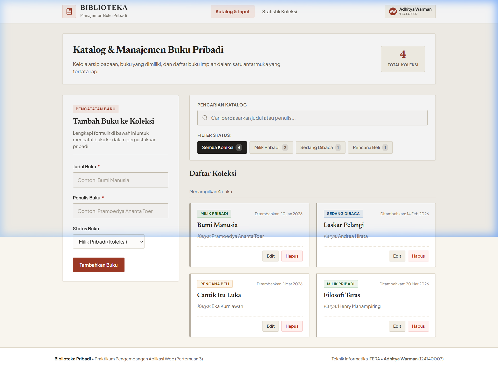
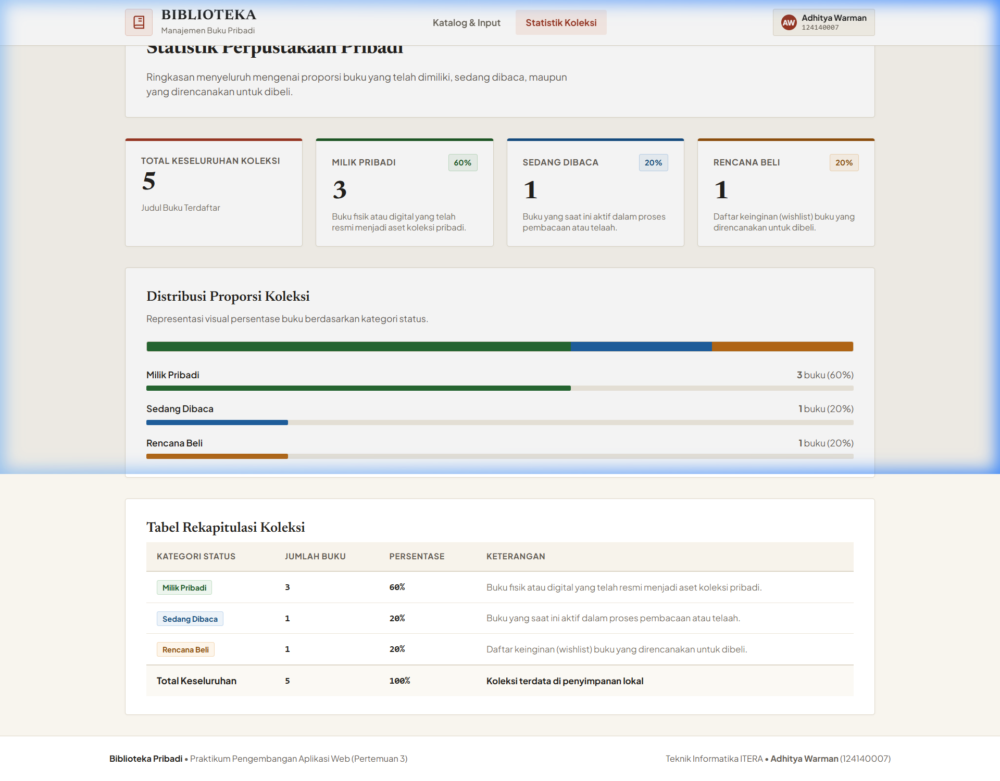

# Biblioteka - Aplikasi Manajemen Buku Pribadi
> **Tugas Praktikum Pertemuan 3: Pengembangan Aplikasi Web**  
> **Teknik Informatika - Institut Teknologi Sumatera (ITERA)**

---

## Identitas Pengembang
- **Nama** : Adhitya Warman
- **NIM**  : 124140007
- **Kelas**: Praktikum Pengembangan Aplikasi Web (PAW) - Pertemuan 3

---

## (a) Deskripsi Aplikasi
**Biblioteka** adalah aplikasi web modern berbasis React dan Vite yang dirancang khusus untuk manajemen katalog dan inventaris buku perpustakaan pribadi. Aplikasi ini mengusung estetika perpustakaan klasik bertema *warm parchment & deep ink* yang rapi, fungsional, dan ramah aksesibilitas.

### Fitur Utama:
1. **Pencatatan & Penambahan Buku**: Menambahkan buku baru dengan atribut judul, nama penulis, dan status bacaan (`milik`, `baca`, atau `beli`).
2. **Validasi Formulir Ketat**: Judul dan nama penulis wajib diisi (input yang hanya berisi spasi/whitespace ditolak secara otomatis). Menampilkan pesan error spesifik dan penanda visual border merah di bawah kolom input yang bermasalah. Pesan kesalahan hilang secara reaktif saat pengguna mulai memperbaiki input.
3. **Penyuntingan & Penghapusan**:
   - Fitur edit untuk memperbarui judul, penulis, atau status buku.
   - Fitur hapus buku yang dilengkapi dialog konfirmasi interaktif untuk mencegah kehilangan data secara tidak sengaja.
4. **Penyaringan Kategori (Status Filter)**: Menyaring koleksi buku berdasarkan 4 tab status: *Semua Koleksi*, *Milik Pribadi*, *Sedang Dibaca*, dan *Rencana Beli*, lengkap dengan badge indikator jumlah buku.
5. **Pencarian Cerdas**: Pencarian instan berdasarkan judul buku atau nama penulis tanpa membedakan huruf besar/kecil (*case-insensitive*), dilengkapi tombol *clear*.
6. **Persistensi Data Permanen (`localStorage`)**: Koleksi buku disimpan secara lokal di browser melalui custom hook `useLocalStorage`, sehingga data tetap aman dan tidak hilang meskipun halaman dimuat ulang (*refresh*).
7. **Statistik & Analisis Koleksi (`/stats`)**: Halaman khusus yang menyajikan metrik total buku, rincian per status, persentase proporsi koleksi, visualisasi *stacked progress bar*, dan tabel rekapitulasi data.
8. **Navigasi Multi-Halaman & Penanganan 404**: Dibangun menggunakan React Router (`react-router-dom`) dengan bilah navigasi atas yang persisten dan halaman 404 sederhana untuk tautan yang tidak terdaftar.

---

## (b) Instruksi Instalasi dan Menjalankan

### Kebutuhan Sistem:
- Node.js (versi 18 ke atas)
- npm (versi 9 ke atas)

### Langkah-langkah Menjalankan:

1. **Masuk ke folder proyek**:
   ```bash
   cd Adhitya Warman_124140007_pertemuan3
   ```

2. **Pasang seluruh dependensi**:
   ```bash
   npm install
   ```

3. **Menjalankan server pengembangan lokal (Development Mode)**:
   ```bash
   npm run dev
   ```
   Aplikasi dapat diakses melalui peramban di [http://localhost:5173/](http://localhost:5173/).

4. **Menjalankan pengujian otomatis (Unit & Integration Tests)**:
   ```bash
   npm test
   ```

5. **Membangun versi produksi (Production Build)**:
   ```bash
   npm run build
   ```

---

## (c) Screenshot Aplikasi

Berikut adalah dokumentasi tampilan antarmuka aplikasi dari folder `docs/`:

### 1. Halaman Utama (Katalog, Formulir, Filter & Pencarian)


### 2. Halaman Statistik Koleksi (`/stats`)


---

## (d) Penjelasan Fitur React & Lokasi File

Aplikasi ini mengimplementasikan konsep-konsep inti React secara komprehensif:

| Fitur React | Penjelasan Implementasi | Lokasi File |
| :--- | :--- | :--- |
| **`useState`** | Digunakan untuk mengelola state lokal pada formulir (`formData`, `errors`), filter aktif, kata kunci pencarian, dan buku yang sedang diedit. | [BookForm.jsx](src/components/BookForm/BookForm.jsx), [BookContext.jsx](src/context/BookContext.jsx), [useLocalStorage.js](src/hooks/useLocalStorage.js) |
| **`useEffect`** | Digunakan untuk menyinkronkan state ke `localStorage` secara otomatis saat data berubah, serta mereset atau mengisi form saat mode edit aktif. | [useLocalStorage.js](src/hooks/useLocalStorage.js), [BookForm.jsx](src/components/BookForm/BookForm.jsx) |
| **`Context API`** | Menyediakan state terpusat untuk daftar koleksi buku, filter status, kata kunci pencarian, dan method mutasi data (`addBook`, `editBook`, `deleteBook`) yang dapat diakses melalui custom hook `useBooks()`. | [BookContext.jsx](src/context/BookContext.jsx) |
| **`React Router`** | Mengatur navigasi multi-halaman (`/`, `/stats`, dan fallback `*` untuk 404) menggunakan komponen `BrowserRouter`, `Routes`, `Route`, `NavLink`, dan `Link`. | [App.jsx](src/App.jsx) |
| **Custom Hooks** | 1. `useLocalStorage(key, initialValue)`: State yang tersinkron aman dengan `localStorage` (dilengkapi proteksi `try/catch`).<br>2. `useBookStats(books)`: Menghitung total buku, jumlah per kategori, dan persentase distribusi proporsi secara ter-memoize. | [useLocalStorage.js](src/hooks/useLocalStorage.js), [useBookStats.js](src/hooks/useBookStats.js) |
| **`PropTypes`** | Validasi tipe props saat runtime untuk memastikan integritas data komponen, termasuk definisi `bookShape` untuk struktur objek buku. | Di seluruh file komponen: [BookForm.jsx](src/components/BookForm/BookForm.jsx), [BookList.jsx](src/components/BookList/BookList.jsx), [BookFilter.jsx](src/components/BookFilter/BookFilter.jsx), [BookContext.jsx](src/context/BookContext.jsx), [Home.jsx](src/pages/Home/Home.jsx), [Stats.jsx](src/pages/Stats/Stats.jsx), [App.jsx](src/App.jsx) |
| **Controlled Components** | Semua elemen input teks dan select pada formulir serta kolom pencarian dikendalikan penuh oleh React state (`value` & `onChange`). | [BookForm.jsx](src/components/BookForm/BookForm.jsx), [BookFilter.jsx](src/components/BookFilter/BookFilter.jsx) |
| **Key pada List** | Setiap elemen list yang di-render melalui perulangan `.map()` memiliki atribut `key` unik (seperti `book.id` atau kode status unik). | [BookList.jsx](src/components/BookList/BookList.jsx), [BookFilter.jsx](src/components/BookFilter/BookFilter.jsx), [Stats.jsx](src/pages/Stats/Stats.jsx) |
| **Conditional Rendering** | Menampilkan tanda visual kesalahan validasi (border merah dan pesan error), teks mode tambah vs edit, status tombol, serta tampilan pesan kosong (*empty state*) ketika data tidak ditemukan. | [BookForm.jsx](src/components/BookForm/BookForm.jsx), [BookList.jsx](src/components/BookList/BookList.jsx), [Stats.jsx](src/pages/Stats/Stats.jsx) |

---

## (e) Daftar Pengujian (Unit & Integration Tests)

Pengujian dilakukan menggunakan **Vitest** dan **React Testing Library** dalam lingkungan **jsdom**. Seluruh 13 pengujian berhasil lulus 100%.

| No | Modul / Berkas Uji | Deskripsi Skenario Pengujian | Hasil |
| :---: | :--- | :--- | :---: |
| 1 | `BookForm.test.jsx` | Memverifikasi kemunculan pesan error dan border merah saat judul atau penulis kosong / spasi, serta memastikan pesan hilang setelah diisi. | **PASS** |
| 2 | `BookForm.test.jsx` | Memverifikasi bahwa handler `onSubmit` dipanggil dengan data objek buku yang tepat saat seluruh isian valid. | **PASS** |
| 3 | `BookList.test.jsx` | Memverifikasi tampilan pesan kosong (*empty state*) jika array buku kosong, serta menampilkan data buku dan tombol aksi jika tersedia. | **PASS** |
| 4 | `BookFilter.test.jsx` | Memverifikasi perpindahan status filter saat tombol diklik dan pemanggilan handler saat pengguna mengetik di kolom pencarian. | **PASS** |
| 5 | `useBookStats.test.js` | Memverifikasi perhitungan total buku, jumlah tiap status (`milik`, `baca`, `beli`), dan persentase yang aman dari pembagian dengan nol. | **PASS** |
| 6 | `useLocalStorage.test.js` | Memverifikasi pembacaan nilai default, penyimpanan nilai terupdate ke `localStorage`, dan kehandalan fallback saat data JSON rusak (*corrupted JSON*). | **PASS** |
| 7 | `AppFlow.test.jsx` | Pengujian integrasi alur aplikasi end-to-end: render layout, tambah buku baru, pencarian reaktif, dan penghapusan buku dengan konfirmasi. | **PASS** |

> Hasil lengkap terminal pengujian otomatis telah diekspor dan dapat dilihat pada berkas: [`docs/laporan-testing.txt`](docs/laporan-testing.txt).

---

## (f) Identitas Pembuat
- **Nama Lengkap** : Adhitya Warman
- **NIM**          : 124140007
- **Program Studi**: Teknik Informatika
- **Mata Kuliah**  : Pengembangan Aplikasi Web (Praktikum Pertemuan 3)
- **Tahun Ajaran** : 2026
